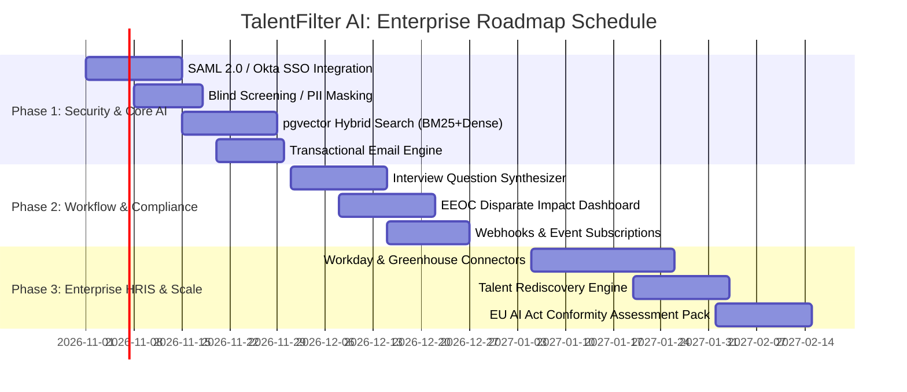

# TalentFilter AI: Enterprise Product Roadmap & Strategic Gap Analysis
**Joint Advisory Framework: Google Product Management & Deloitte Human Capital / Tech Risk Advisory**

---

## 1. Executive Summary

### Current Baseline Status (Production MVP Achieved)
The TalentFilter AI platform currently implements a robust, battle-tested baseline:
- **Core Engine**: PyMuPDF and `python-docx` parsing with OCR fallback; deterministic keyword, boundary, and synonym matching; dynamic criteria weights; and transparent explainability breakdowns.
- **Governance**: Decoupled automated recommendations from final HR decisions; mandatory confirmation and justification for rejections; and tamper-evident audit logging.
- **Frontend & APIs**: Next.js 14+ App Router dashboard with live metrics, candidate filtering, dual-pane document/score review, and Docker Compose deployment.

### The Enterprise Mandate
To transform TalentFilter AI from a standalone screening tool into an **enterprise-ready Talent Intelligence & Compliance Platform** deployed across Fortune 500 enterprises, global consulting firms, and hyperscale environments, we must address **algorithmic accountability, enterprise ecosystem interoperability, AI/ML retrieval scalability, and candidate engagement**.

---

## 2. Strategic Gap Analysis & Roadmap Pillars

```
+---------------------------------------------------------------------------------------+
|                             TalentFilter AI Enterprise Ecosystem                     |
+---------------------------+-----------------------------+-----------------------------+
|   Deloitte Advisory Lens  |      Shared Foundation      |       Google PM Lens        |
| - EU AI Act & EEOC Bias   | - Deterministic Baseline    | - Hybrid Search (pgvector)  |
| - SAML/SSO & SCIM Sync    | - Human-in-the-Loop Gate    | - Active Learning Weights   |
| - Blind Screening Mode    | - Multi-Job Candidate Graph | - Interview Synthesizer     |
| - Workday / SAP Connectors| - Immutable Audit Trail     | - Candidate Portal & Comms  |
+---------------------------+-----------------------------+-----------------------------+
```

---

### Pillar 1: Enterprise Security, Multi-Tenancy & Compliance (Deloitte Advisory Lens)

#### 1.1 Multi-Tenancy & Row-Level Security (RLS)
- **Current State**: Single organization database schema with user roles.
- **Gap**: Enterprise customers require strict tenant isolation, customizable data retention rules, and customer-managed encryption keys (CMEK).
- **Required Action**:
  - Implement tenant isolation via PostgreSQL Row-Level Security (RLS) or dedicated tenant schemas.
  - Implement AWS KMS / GCP Cloud KMS envelope encryption for candidate resume documents at rest.

#### 1.2 Enterprise SSO & Identity Lifecycle Management
- **Current State**: Local email/password with JWT bearer tokens.
- **Gap**: Enterprise IT requires single sign-on (SSO) and automatic deprovisioning when recruiters leave the organization.
- **Required Action**:
  - SAML 2.0 and OIDC integrations (Okta, Azure Active Directory / Entra ID, Google Workspace).
  - SCIM 2.0 protocol for automated user onboarding, role synchronization, and offboarding.

#### 1.3 Regulatory Compliance: EEOC & EU AI Act Conformity
- **Current State**: Demographic fields are excluded from scoring; decisions require human confirmation.
- **Gap**: The **EU AI Act classifies AI employment screening as "High-Risk" (Annex III, point 4)**. US federal guidelines (EEOC & OFCCP) enforce disparate impact scrutiny.
- **Required Action**:
  - **Four-Fifths Rule (Disparate Impact) Auditing Dashboard**: Automated statistical checking to ensure screening recommendations do not disproportionately disfavor protected demographic groups.
  - **Conformity Assessment Documentation**: Generate verifiable risk mitigation documents, bias testing logs, and human oversight audit exports required under EU AI Act Article 9 & 14.
  - **Blind Screening Mode (Anonymization Toggle)**: One-click option to redact candidate name, email, university names (mitigating prestige bias), and graduation dates (mitigating age inference) during the preliminary review phase.

#### 1.4 Data Privacy & "Right to be Forgotten" (GDPR / CCPA)
- **Current State**: Resumes stored persistently; deletion requires manual database operations.
- **Gap**: Candidates have legal rights to request data deletion, erasure verification, and data export.
- **Required Action**:
  - Automated candidate data purge endpoints adhering to GDPR Article 17.
  - Configurable data retention policies (e.g. purge candidate files 180 or 365 days post-application).

---

### Pillar 2: AI & Semantic Retrieval Scalability (Google PM Lens)

#### 2.1 Hybrid Search: BM25 Keyword + Dense Vector Embeddings (pgvector)
- **Current State**: Deterministic regex and synonym dictionary matching.
- **Gap**: Candidates with equivalent domain experience described in nontraditional phrasing (e.g., *"orchestrated fault-tolerant cloud backplanes"* vs *"Docker Kubernetes microservices"*) can be underscored.
- **Required Action**:
  - Deploy **pgvector** inside PostgreSQL.
  - Generate embeddings using models such as Google Vertex AI `text-embedding-004` or HuggingFace BGE.
  - Implement **Reciprocal Rank Fusion (RRF)**:
    $$\text{Hybrid Score} = \alpha \cdot \text{Dense Semantic Similarity} + (1 - \alpha) \cdot \text{Deterministic Rule Match}$$
  - Maintain the deterministic breakdown as the primary explainability anchor.

#### 2.2 Active Learning & Recruiter Feedback Loop
- **Current State**: Criteria weights and synonym dictionaries are static unless edited manually.
- **Gap**: System does not learn from repeated recruiter overrides.
- **Required Action**:
  - Implement an **Active Learning Telemetry Service**: When recruiters consistently shortlist candidates who scored lower on specific criteria, flag the criterion for automated weight recommendation.
  - Allow HR leads to approve recommended weight adjustments based on aggregate historical decisions.

#### 2.3 Semantic Resume Chunking & Grounded Citation Verification
- **Current State**: Full document text is evaluated in aggregate.
- **Gap**: Complex multi-page CVs can mix responsibilities across 10-year timelines.
- **Required Action**:
  - Implement structured AST chunking dividing resumes into explicit chronological nodes: `[Role, Organization, Duration, Responsibilities, Technologies]`.
  - Provide direct highlight bounding boxes on the PDF canvas indicating the exact sentence where a skill was identified.

---

### Pillar 3: Workflow Velocity & Candidate Communication (Google PM Lens)

#### 3.1 Automated Candidate Communications & Status Transparency
- **Current State**: HR records decisions internally; candidate notifications must be handled externally.
- **Gap**: Lack of automated communication prolongs time-to-hire and creates negative candidate experience ("recruiting black hole").
- **Required Action**:
  - Event-driven transactional messaging engine (SendGrid, Resend, Amazon SES).
  - Configurable email templates triggered by HR decisions (e.g., *Application Received*, *Advancing to Phone Screen*, *Polite Rejection with Constructive Feedback*).
  - Rate-limited candidate status tracking portal with neutral candidate view.

#### 3.2 AI-Powered Technical Interview Question Synthesizer
- **Current State**: System highlights missing or uncertain criteria.
- **Gap**: Recruiters must manually draft interview probes to investigate candidate ambiguities.
- **Required Action**:
  - Automatically synthesize 3–5 role-specific behavioral and technical interview questions targeting the candidate's exact **uncertain criteria** and **borderline requirements**.
  - Output interview scorecards exportable directly into recruiter notes.

#### 3.3 Interview Scheduling Automation
- **Current State**: Scheduling must be performed out-of-band.
- **Gap**: Administrative coordination friction between recruiters, hiring managers, and candidates.
- **Required Action**:
  - Google Calendar & Microsoft 365 calendar synchronization.
  - Multi-interviewer availability booking links embedded in shortlist communications.

---

### Pillar 4: Enterprise Ecosystem & HRIS Interoperability (Deloitte Advisory Lens)

#### 4.1 Enterprise HRIS & ATS Ingestion Connectors
- **Current State**: Direct file upload via web dashboard or REST API.
- **Gap**: Large organizations require automated two-way synchronization with their primary HRIS.
- **Required Action**:
  - Native bi-directional connectors:
    - **Workday**: Workday Web Services (WWS) integration for job requisitions and candidate status updates.
    - **Greenhouse & Lever**: Harvest API & webhook web listeners.
    - **SAP SuccessFactors**: OData API integrations.

#### 4.2 Webhook Engine & Event-Driven Architecture
- **Current State**: Internal in-process / Celery processing.
- **Gap**: Third-party HR tech tools cannot subscribe to candidate lifecycle events.
- **Required Action**:
  - Webhook dispatcher with HMAC-SHA256 signature verification.
  - Standardized event topics: `candidate.uploaded`, `screening.completed`, `hr.decision.shortlisted`, `hr.decision.rejected`.

---

### Pillar 5: Advanced Analytics & Talent Intelligence (Joint Lens)

#### 5.1 Talent Pipeline Analytics & Velocity Dashboard
- **Current State**: High-level summary metrics (counts by status).
- **Gap**: HR leadership lacks visibility into hiring funnel bottlenecks, sourcing channel ROI, and stage-gate conversion rates.
- **Required Action**:
  - Time-to-screen and time-to-decision velocity metrics.
  - Funnel drop-off analytics: View applicant attrition at each stage.
  - Recruiter calibration analytics: Compare reviewer scoring distributions across hiring managers to eliminate grading bias.

#### 5.2 Internal Mobility & Talent Rediscovery
- **Current State**: Resumes are screened primarily against the uploaded job opening.
- **Gap**: Qualified silver-medalist candidates rejected for Job A are lost to future requisitions.
- **Required Action**:
  - "Talent Pool Rediscovery" engine: When a new job opening is published, automatically query the historical candidate repository for matches above 80% qualification and prompt recruiters with rediscovery recommendations.

---

## 3. Phased Implementation Roadmap



### Phase 1: Security, Blind Screening & Hybrid Retrieval (Weeks 1–4)
- [ ] Implement SAML 2.0 / OIDC single sign-on.
- [ ] Add "Blind Screening Mode" toggle on candidate review dossier.
- [ ] Upgrade PostgreSQL with `pgvector` for hybrid semantic retrieval.
- [ ] Integrate SendGrid/Resend for automated recruiter notification emails.

### Phase 2: Workflow Acceleration & Compliance Dashboards (Weeks 5–8)
- [ ] Build automated Interview Question Synthesizer targeting candidate uncertainty gaps.
- [ ] Deploy EEOC 4/5ths Rule statistical bias monitoring dashboard.
- [ ] Implement outbound webhook infrastructure with cryptographic signing.
- [ ] Build Google Calendar & Outlook scheduling integration.

### Phase 3: Enterprise HRIS & Regulatory Conformity (Weeks 9–14)
- [ ] Build native Workday and Greenhouse bi-directional ingestion pipelines.
- [ ] Implement Talent Rediscovery across historical candidate pools.
- [ ] Finalize EU AI Act High-Risk technical documentation package and audit exports.
- [ ] Implement multi-region tenant database partitioning for international data sovereignty.

---

## 4. Key Performance Indicators (KPIs) & Target Metrics

| Metric Category | KPI | Baseline | Target (Post-Roadmap) |
| :--- | :--- | :--- | :--- |
| **Operational Velocity** | Time-to-Screen per Resume | 4.5 minutes (manual) | < 15 seconds |
| **Decision Quality** | Recruiter Shortlist Conversion Rate | ~30% | > 70% |
| **Governance & Safety** | Automated Rejection Incidents | 0 (Enforced) | 0 (Strict HITL) |
| **Algorithmic Fairness** | Disparate Impact Ratio | Unmonitored | 0.80 - 1.25 (Compliant) |
| **Ecosystem Reach** | HRIS Sync Latency | N/A (Manual Upload) | < 60 seconds (Webhook) |
| **Candidate Engagement**| Time to Candidate Status Notification | 7–14 days | < 24 hours |

---

*Authored by the Google Product Management & Deloitte Enterprise Risk Advisory Pair Programming Team.*
